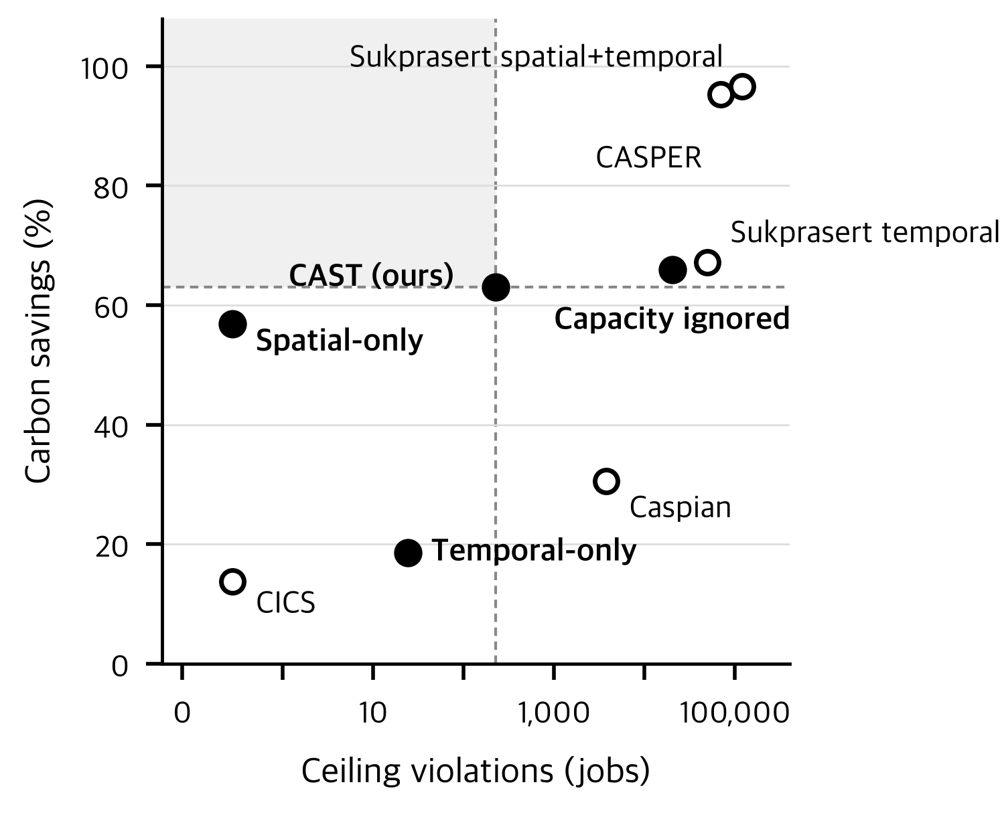
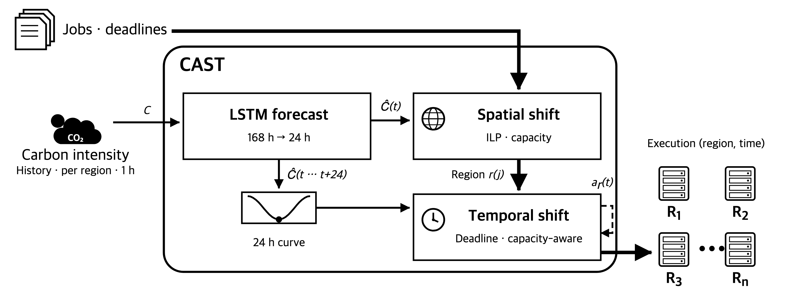
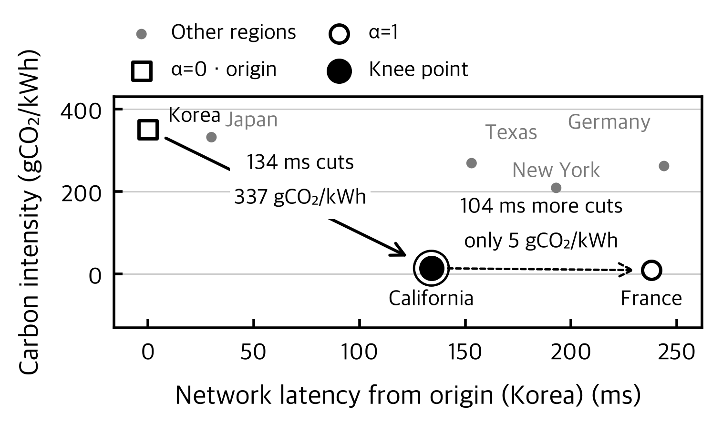
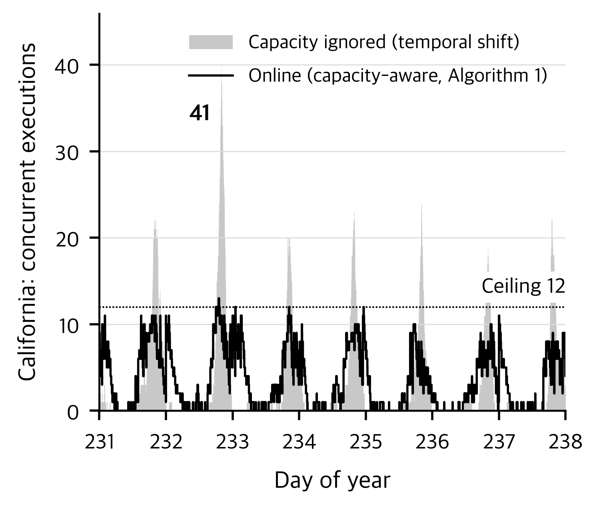
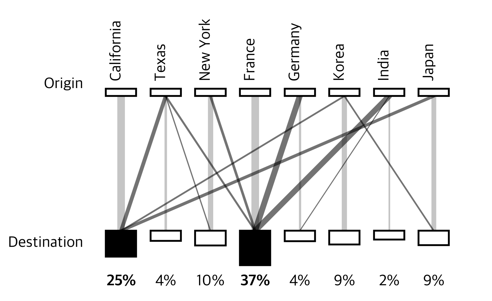

<div align="center">

# CAST — Carbon-Aware Spatio-Temporal Scheduling

리전 용량 제약을 고려한 탄소 인지 시공간 워크로드 스케줄링

[](https://www.python.org/)
[](https://pytorch.org/)
[-1f6feb)](https://coin-or.github.io/pulp/)
[](https://simpy.readthedocs.io/)
[](https://dash.plotly.com/)
[](#impact)

2026.07 ~ 진행 중 · 4인 팀 개발 · 정보과학회논문지 투고 준비

</div>

---

## 폴더 순서

데이터가 흐르는 순서대로 읽으면 됩니다. 폴더 이름은 코드가 패키지로 불러 쓰므로 바꾸지 않았습니다.

| 순서 | 폴더 | 하는 일 |
|---|---|---|
| ① | [`lstm_source/`](lstm_source/) | LSTM 학습 노트북과 원자료 (모델을 **만든** 쪽) |
| ② | [`carbon_forecast_lstm/`](carbon_forecast_lstm/) | 학습된 예측 모델과 추론 코드 (모델을 **쓰는** 쪽) |
| ③ | [`interface/`](interface/) | 탄소 자료·예측을 모듈에 넘기는 공용 API, 통합 대시보드 |
| ④ | [`load_balancer/`](load_balancer/) | 작업 생성기와 작업 자료(합성·Azure), v1 로드밸런서 |
| ⑤ | [`scheduler/`](scheduler/) | v1 시간 이동 스케줄러, v2 CAST(`joint.py`, `run_v2.py`)와 실험 결과 `data/v2/` |
| — | [`paper/`](paper/) · [`presentation/`](presentation/) · [`tests/`](tests/) | 논문(안내: `paper/폴더안내.txt`) · 발표 · 테스트 |

---

## Impact

| | |
|---|---|
| **−63.03 %** | 8개 리전 1년치 실측 데이터, 작업 146,000건에서 배출량 29,225.6 → 10,805.0 kg |
| **마감 위반 0건** | 146,000건 전량이 마감 이내. 탐색 공간에서 마감 초과를 배제한 설계상의 결과 |
| **용량 위반 89배 감소** | 용량을 보지 않으면 20,208건, 매 슬롯 강제하면 227건 |
| **선행 정책 5종 재현** | 원문 수식·공개 코드 그대로 구현해 같은 회계로 채점 |

---

## Background

**같은 1 kWh라도 언제 어디서 쓰느냐에 따라 배출량이 수십 배 차이납니다.** 2025년 실측에서 프랑스는
13.6 gCO₂/kWh, 인도는 542.9 gCO₂/kWh로 39.9배 벌어지고, 하루 안에서도 재생에너지 비중이 오르내립니다.

그래서 탄소를 줄이는 레버는 둘입니다 — 더 깨끗한 **리전**으로 보내거나(공간 이동), 더 깨끗한
**시간대**로 미루거나(시간 이동).

문제는 선행 연구 대부분이 **리전 용량을 무제한으로 둔다**는 것입니다. 그러면 최적해가 가장 깨끗한
리전 한 곳으로 쏠립니다. 본 실험에서도 작업의 **99.75 %가 프랑스로 몰렸습니다.** 실제로 돌릴 수 없는
배치입니다.

### 선행 정책을 같은 회계로 다시 채점하면

<div align="center">

</div>

| 정책 | 총 배출 (kg) | 절감률 | 용량 위반 |
|---|---:|---:|---:|
| CICS Virtual Capacity Curve | 25,203.4 | 13.76 % | 0 |
| Caspian (fractional) | 20,308.4 | 30.51 % | 3,745 |
| Sukprasert temporal | 9,583.6 | 67.21 % | 49,356 |
| CASPER CAP | 1,379.1 | 95.28 % | 69,310 |
| Sukprasert spatial+temporal | 990.8 | 96.61 % | 120,186 |
| **CAST (ours)** | **10,805.0** | **63.03 %** | **227** |

절감률만 보면 CASPER와 Sukprasert가 앞섭니다. 다만 **본 연구를 앞서는 네 방식은 모두 상한 위반이
20,208건 이상**이고, 선행 정책 중 가장 적은 것도 49,356건으로 본 연구의 217배입니다.

상한 12는 기준 배정이 실제로 도달한 최대치(13건)의 92 %입니다. 이를 넘기는 배정은 **그 워크로드가
한 번도 요구한 적 없는 동시 실행 수를 전제**합니다.

> 용량을 함께 보고하지 않으면 탄소 절감률은 비교할 수 없는 숫자입니다.

---

## Architecture

<div align="center">

</div>

예측이 먼저 서고, 공간 이동이 리전을 정한 뒤, 시간 이동이 그 리전 안에서 실행 시각을 옮깁니다.
**배치 결정은 예측값으로, 배출량 산정은 실측값으로** 합니다 — 둘 다 예측값을 쓰면 예측 오차의 대가가
결과에서 사라지기 때문입니다.

세 모듈은 서로의 내부 구현을 모릅니다. `interface/`가 주고받는 데이터 형식만 정의하는 경계 계층이라,
한쪽 구현이 바뀌어도 계약만 지키면 나머지는 손대지 않습니다.

| 모듈 | 책임 | 산출물 |
|---|---|---|
| [`carbon_forecast_lstm/`](carbon_forecast_lstm/) | 리전별 향후 24시간 탄소강도 예측 | `{region: [24 × gCO₂/kWh]}` |
| [`load_balancer/`](load_balancer/) | **어느 리전**에서 실행할지 (공간 이동) | `jobs_routed_*.csv` |
| [`scheduler/`](scheduler/) | 그 리전에서 **언제** 실행할지 (시간 이동) | `scheduled_start` · `carbon_emitted` · `slo_satisfied` |
| [`interface/`](interface/) | 모듈 간 데이터 계약 + 통합 대시보드 | `regions.py` · `carbon_forecast_api.py` · `lb_assignment.py` |

ROS 같은 런타임 없이 Python 패키지 넷으로 끊었습니다. 실험을 한 명령으로 재현해야 해서,
프로세스를 가르는 것보다 **데이터 계약을 고정하는 쪽**을 택했습니다.

---

## Contributions

수식과 측정 근거는 [논문 본문](paper/CAST_JOK_v2.pdf)과 [공식 명세](paper/문서/공식.txt)에 있습니다.

### 가중치를 고정하지 않는다 — 슬롯마다 파레토 무릎점



탄소와 지연을 맞바꾸는 가중치 α를 상수로 두지 않고, **매 슬롯 파레토 곡선의 무릎점에서 자동으로**
정합니다.

평균으로는 고정값과 같은 가중치를 쓰는 셈인데도 고정 α=0.5보다 탄소를 **10.64 %포인트 더** 줄입니다
(15,718.6 → 12,609.8 kg). 슬롯마다 리전 간 격차가 다르기 때문입니다.

한 슬롯을 열어 보면 α를 0에서 1까지 옮길 때 목적지가 홈(한국) → 캘리포니아 → 프랑스 세 구간으로만
갈립니다. 무릎점 0.508은 가운데 구간에 들어 **탄소를 홈 대비 96 % 줄이면서 지연은 상한의 55 %만**
씁니다.

<br clear="right"/>

### 리전 용량을 매 슬롯 강제한다



시간 이동이 용량을 보지 않으면 저탄소 시간대로 몰려도 아무것도 막지 않습니다. 실측에서 **동시 실행
수가 여유율 상한의 3.4배(41건)** 까지 올라갔습니다.

슬롯별로 리전 점유량을 추적해 상한에 닿은 슬롯을 후보에서 미리 빼는 온라인 알고리즘을 적용하면

- 최대 동시 실행 **41건 → 17건**
- 캘리포니아 초과 시간 **866.9시간 → 7.25시간**
- 상한 위반 **20,208건 → 227건** (89배)

남은 227건은 마감 직전이라 강제 편입된 106건과 옮길 자리가 없어 즉시 실행된 121건입니다.
**정상 경로의 위반은 0건**이고, 어떤 작업도 무한히 연기되지 않습니다.

<br clear="right"/>

### 총계가 아니라 분포가 문제다

<div align="center">

</div>

용량을 두지 않았을 때 시간 이동이 만드는 절감의 **71.9 %가 캘리포니아 한 리전**에서 나오고,
그 리전이 상한을 넘긴 시간의 **87.4 %는 UTC 19~21시, 곧 현지 한낮 세 시간**에 몰립니다.

**시간 이동이 값어치를 만드는 리전과 용량이 그것을 가로막는 리전이 같습니다.** 반대로 배정 물량이
가장 많은 프랑스는 종일 평탄해 절감의 2.3 %만 냈습니다.

> 시간 이동을 도입할지는 리전별 탄소강도의 **평균이 아니라 변동 폭**으로 판단해야 합니다.

### 예측을 더 잘하는 것보다 용량을 다루는 것이 크다

예측 오차의 비용은 실제 LSTM 예측(63.03 %)과 완전예지 오라클(10,627.3 kg, 63.64 %)의 차이인
**0.61 %포인트**인 반면, 용량의 비용은 **2.90 %포인트**로 네 배가 넘습니다.

오라클 예측을 넣으면 위반이 227건에서 873건으로 **늘어납니다** — 예측이 정확할수록 작업이 같은 저탄소
구간에 모이고, 그 수렴이 초과를 만듭니다.

### 한 명령으로 재현된다

논문의 모든 표와 헤드라인 수치를 [`scheduler/reproduce.py`](scheduler/reproduce.py) 하나로 재생성합니다.
함수마다 대응하는 작업 일지 항목 번호를 docstring에 적어 두어, 숫자가 어긋나면 그 항목을 먼저 열면 됩니다.

```bash
./.venv/bin/python -m scheduler.reproduce              # 표만, 수 초
./.venv/bin/python -m scheduler.reproduce --full       # 용량 스윕까지 전부 재계산
./.venv/bin/python -m scheduler.reproduce --sensitivity # 민감도 실험 3종
```

---

## Troubleshooting

### 한 시간 늦은 예측을 보고 있었다

- **문제** 용량 인지 온라인 결과가 설명되지 않는 수준으로 낮게 나옴
- **원인** Algorithm 1의 후보 채점이 `pred24[h][0]`을 h시의 예측으로 읽었는데 실제로는 **h+1시의 값**. 오프바이원
- **해결** 인덱스 보정 후 전 과정 재실행
- **결과** 63.03 %로 갱신(이전 62.94 %). **완전예지 오라클 10,627.3 kg이 소수점까지 불변**인 것이 회귀 검증이 됨 — 오라클은 예측을 쓰지 않으므로 바뀌면 안 된다

### 같은 "기준 배출"에 값이 둘이었다

- **문제** 리전별 배출 비중을 계산했더니 논문의 일본 16.3 %가 16.2 %로 나옴
- **원인** 이 저장소에 **회계가 둘**. `integrate_gco2`는 29,182.6 kg, `mean_carbon`은 29,225.6 kg. 논문 정본은 후자인데 앞의 CSV를 집었다
- **해결** `reproduce.py` 46–48행 주석이 정확히 이 함정을 경고하고 있었다. 정본 회계로 재계산
- **결과** 일본 16.2528 → **16.3 %** 로 논문이 맞음. 상위 4개 리전 raw 합도 69.6868 → 69.7 %로 일치

> 숫자를 꺼내기 전에 **기존 값과 먼저 맞춰 봅니다.** 이 사고도 10,805/29,182 = 62.97 ≠ 63.03이 걸려서 잡혔습니다.

### CI가 14개 커밋째 빨간불이었다

- **문제** 테스트가 Python 3.12 잡에서만 실패. 3.11과 로컬은 통과
- **원인** **PuLP 4.0.0이 `LpVariable(cat=...)`을 없앴다.** 4.0.0은 `requires-python >=3.12`라 3.12 잡만 그걸 받음. `pyproject.toml`에 상한이 없었다
- **해결** `pulp>=2.9,<4`로 고정. 코드를 PuLP 4에 맞추지 **않은** 이유는 논문 수치가 PuLP 3.x로 낸 결과이기 때문
- **결과** 3.11·3.12·로컬이 모두 PuLP 3.3.2를 받아 같은 환경이 됨

> Actions 로그는 admin 권한이라 받지 못했습니다. 대신 runs API로 마지막 성공 커밋을 찾고, 그 경계 diff에서
> **테스트와 대상 모듈이 한 줄도 안 바뀐 것**을 확인해 "코드가 아니라 환경"으로 좁혔습니다.

---

## 실행

```bash
# 설치
python -m venv .venv && source .venv/bin/activate
pip install -e ".[dev]"          # LSTM 실모델까지: pip install -e ".[dev,lstm]"

# 재현
python -m scheduler.reproduce

# 통합 대시보드
cast-dashboard                   # http://127.0.0.1:8050
```

> [!NOTE]
> `torch`가 없으면 LSTM은 **더미(사인파+노이즈)로 자동 폴백**합니다. CI가 그렇게 돕니다.
> 1년 실험은 2025년 사전 계산된 예측·실측 기록을 쓰므로 torch 없이도 재현됩니다.

---

## 한계

| 한계 | 왜 남아 있나 | 다음 |
|---|---|---|
| **작업 발생과 리전 용량을 균등하다고 두었다** | 기준 배출의 69.7 %가 인도·일본·한국·텍사스 넷에서 나오는데 실제 수요와 설비는 균등하지 않다 | 수요에 비례하는 용량 모델 |
| **실제 배포가 아닌 시뮬레이션** | 클러스터 관리 계층과의 연동 비용을 확인하지 못했다 | Kubernetes 연동 |
| **기상 입력이 예보가 아닌 실측값** | 캘리포니아·텍사스·독일 세 리전의 결과는 낙관적일 수 있다 | 날씨 예보 API 연동 |
| **예측 지평 24시간까지만 시험** | 그 이상은 선행 연구가 따로 다루는 문제 | 다일 예측 적용 |
| **지연 등급 분포가 설정값** | 실측 워크로드 트레이스가 없다 | 공개 트레이스 대조 |
| 탄소 회계가 average intensity 기준 | marginal emission factor는 데이터가 리전마다 고르지 않다 | marginal 회계 병행 |

등급 분포를 여섯 가지로 바꿔 전 과정을 다시 돌린 민감도 실험에서 용량·예측의 비용 배율이 0.23배에서
6.14배까지 벌어졌고, **유연한 작업이 약 27 % 아래로 내려가면 순서가 뒤집힙니다**(본 연구는 39.92 %).

---

## 문서

| | |
|---|---|
| [논문 (PDF)](paper/CAST_JOK_v2.pdf) | 정보과학회논문지 **투고 예정본** |
| [공식 명세](paper/문서/공식.txt) | 기호·수식 단일 기준 — 코드와 다르면 이 파일이 맞다 |
| [작업 일지](paper/문서/정리.txt) | 날짜별 실험·수정 기록과 사고 전말 |
| [그림 검수 규약](paper/문서/그림_검수규약.txt) | 렌더해서 400 % 확대로 본다 — 코드만 읽고 판단하지 않는다 |
| [영문 용어집](paper/문서/영문화_용어집_확정.txt) | 용어마다 출처 표시 (초록/원문/관행/조어) |
| [JOK 투고규정 전문](paper/문서/JOK규정_전문.txt) | 근거 URL 10개와 md5 포함 |
| 모듈별 README | [LSTM](carbon_forecast_lstm/README.md) · [로드밸런서](load_balancer/README.md) · [스케줄러](scheduler/README.md) · [인터페이스](interface/README.md) |

---

## 대상 리전

`US-CAL-CISO` · `US-TEX-ERCO` · `US-NY-NYIS` · `FR` · `DE` · `KR` · `IN` · `JP`

리전 간 지연은 **Azure inter-region round-trip latency** 공식 통계(8×8 대칭 행렬, 최댓값 244 ms ·
비대각 최솟값 12 ms)를 사용합니다.

---

## 라이선스

| 대상 | 조건 |
|---|---|
| 소스 코드 | [MIT License](LICENSE) |
| [`paper/`](paper/) — 논문·그림·작업 문서 | **저작권 유보** · All rights reserved ([전문](paper/LICENSE)) |

논문은 정보과학회논문지 투고 예정본입니다. 열람은 자유이나 저자의 사전 허락 없이
복제·재배포하거나 다른 학술지·프리프린트 서버에 제출할 수 없습니다. 인용은 통상의
학술 관행에 따릅니다.

---

## 팀

세 모듈은 담당자별로 독립 개발되었고, `interface/` 계약 계층을 통해 하나의 파이프라인으로 통합되었습니다.

| 영역 | 담당 | 디렉터리 |
|---|---|---|
| ① 탄소강도 예측 (LSTM) | **강희진** ([@heejin116](https://github.com/heejin116)) | [`carbon_forecast_lstm/`](carbon_forecast_lstm/) |
| ② 공간 이동 (ILP 로드밸런서) | **이종하** ([@bell-ha](https://github.com/bell-ha)) | [`load_balancer/`](load_balancer/) |
| ③ 시간 이동 (Time-Shift 스케줄러) | **강동규** ([@donggyu-kang](https://github.com/donggyu-kang)) | [`scheduler/`](scheduler/) |
| 통합 인터페이스 · 데이터 계약 | **김현정** ([@HyeonJeong-S](https://github.com/HyeonJeong-S)) | [`interface/`](interface/) |
